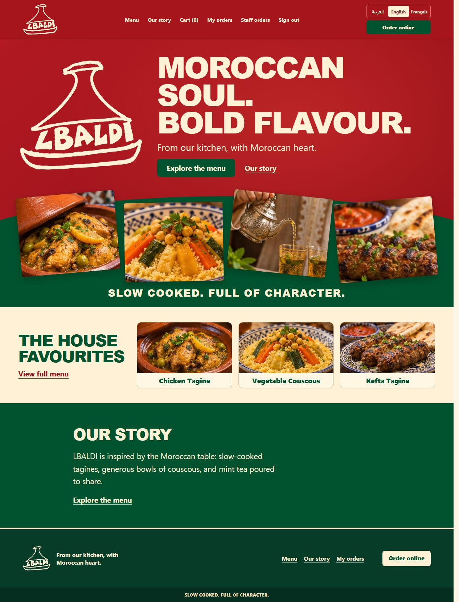

# LBALDI — Moroccan Restaurant

LBALDI is a full-stack restaurant app built with Vue, TypeScript, Node.js, and Neon Postgres. Customers can browse a Moroccan menu, place an order, and follow it from the kitchen to ready.



## Features

- **Customers:** Browse dishes, adjust quantities in the cart, and track orders in **My orders**.
- **Staff:** Move orders from **New** to **Working on it** to **Done**, edit dishes, upload photos, and mark dishes unavailable.
- **Managers:** Invite staff and remove their access from the dashboard.
- **Languages:** Switch between Arabic, English, and French. The layout reads right to left in Arabic.

The menu uses Neon Realtime for updates, and the downloadable English menu is stored in Neon Object Storage. The cart resets on refresh; orders placed while signed in remain in **My orders**.

## Run locally

Use Node.js 24.11 or later. Run these commands from the project root after linking it with the Neon CLI.

```sh
npm ci
npm ci --prefix frontend
neon deploy
npm run setup:data
npm run setup:orders
npm run setup:photos
npm run setup:staff
npm run build
npm start
```

Open `http://127.0.0.1:4173/`. `neon deploy` writes server credentials to an ignored `.env.local` or existing `.env`. `npm run setup:data` inserts missing starter dishes and publishes a fresh menu snapshot to the private `assets` bucket.

For frontend development, leave the backend running and use `npm --prefix frontend run dev` in another terminal. Vite proxies requests under `/api` to the Node server.

## Share a public demo

1. Commit and push the latest code to GitHub. The root `render.yaml` sets up one free Node Web Service for the site and API. Keep local `.env` files out of Git.
2. Prepare a separate Neon demo branch or project with sample menu data and no private order or account history. Run the `setup:*` commands above against that demo database before deploying. Use that branch's Neon credentials when Render prompts for them. Set `NEON_AUTH_BASE_URL` and `VITE_NEON_AUTH_URL` to the same Auth base URL from the demo branch. Keep manager and staff permissions empty unless deliberately setting up demo staff accounts.
3. In the [Render dashboard](https://dashboard.render.com/), create a **Blueprint** from the GitHub repository. Once it deploys, add the new `https://…onrender.com` origin to **Auth → Configuration → Domains** on the demo branch in Neon. Test the menu, sign-in, and a sample order from the public URL before sharing it.

The free web service may take about a minute to wake up after being idle. See [Render's free plan details](https://render.com/docs/free) and [Neon trusted domains](https://neon.com/docs/auth/guides/configure-domains).

## Staff orders and languages

Everyone signs in at `/sign-in`. Enable Better Auth on the Neon branch your app uses and copy its Base URL. Set `NEON_AUTH_BASE_URL` in the root environment file Neon already populated (`.env` or `.env.local`). Set `VITE_NEON_AUTH_URL` to the same URL in `frontend/.env.local`, then rebuild the frontend.

To set up the first manager, add their Neon Auth user ID to `MANAGER_USER_IDS` in that same root environment file, then restart the backend. Existing staff IDs in `STAFF_USER_IDS` still work. Invitations grant staff access only.

Managers open **Staff orders → Manage staff access**, enter an email, and share the private invitation link. The recipient signs in using that email or creates their own account, then accepts the invitation. Managers can remove that staff permission from the same page. Run `npm run setup:staff` once per database branch to create the invitation table.

Open **Staff orders → Manage menu** to add a dish or edit its name, description, price in MAD, photo, and availability. Use **Choose photo**, or **Take photo** on a supported phone, then save the dish. The app resizes uploaded photos and stores them in Postgres. Run `npm run setup:photos` on each branch to create the photo table. You can also use a photo link. Clearing **Available to order** leaves the dish visible but prevents customers from ordering it. The downloadable English text is a separate snapshot refreshed by `npm run setup:data`.

**Staff orders** groups orders into **New**, **Working on it**, and **Done**. An order moves to the selected section when staff save a new status. Customers can track orders they place while signed in under **My orders**. Guest orders and orders placed before account tracking stay visible to staff. Run `npm run setup:orders` on each branch before starting the updated app.

The language buttons switch the interface between English, French, and Arabic. Translations for existing dishes live in `frontend/src/utils/dishText.ts`. New dishes display their original names and descriptions until translations are added.

## Check the project

Run these commands from the project root. Leave the app running in a separate terminal for the Neon verification.

```sh
npm --prefix frontend run lint
npm --prefix frontend run format:check
npm test
npm run build
npm run verify:neon
```

The verification checks the built app, Postgres menu API, and stored menu download. It also inserts and removes a temporary row to check that Realtime delivers both changes.
